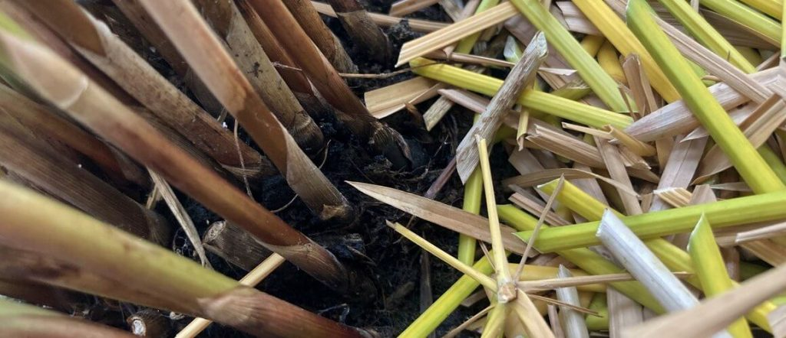
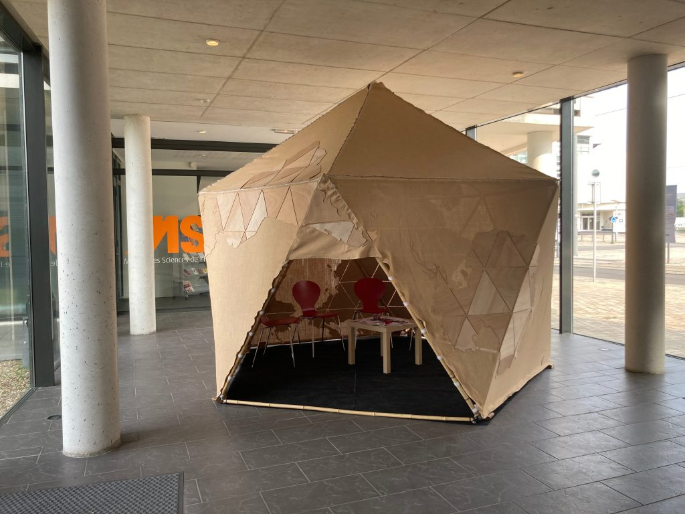
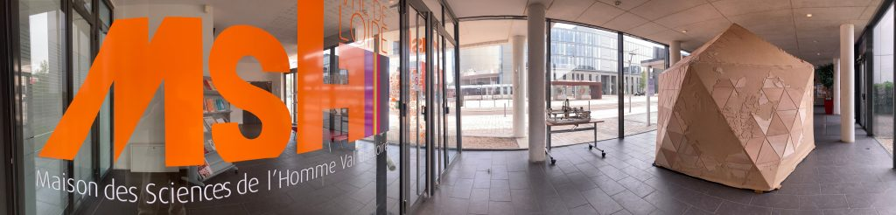

Dans le cadre de l'initiative régionale [**Human Tech Days**](https://www.humantechdays.fr/), proposée par la Région Centre Val de Loire, la Maison des Sciences de l'Homme du Val de Loire accueillera dans ses locaux cette année l'évènement  
**"[Méta-Humus](https://do.doc.neguentropie.art/_publications/meta-humus)" du 27 au 29 juin 2023**.

_Comme l’a montré le philosophe **Bernard Stiegler,** les technologies numériques sont intrinsèquement ambivalentes : lorsqu’elles sont mises au service de l’économie des données et de la captation des attentions, elles donnent lieu à des processus d’uniformisation des pensées et de grégarisation des comportements. A l’inverse, lorsqu’elles sont conçues et développées comme des supports de savoirs contributifs, elles permettent l’expression des singularités et la confrontation des points de vues._ _Face aux innovations, comment mettre le numérique au service de l’intelligence collective ? Cette question sera explorée à travers des réflexions théoriques qui s’articuleront à la présentation d’une œuvre à la fois numérique et sensible._

Coordonnée par Erwan Bozec (Coopérative Artéfact), l'évènement "Méta-Humus" proposera de **découvrir des pratiques ludiques du numérique autour de plusieurs ateliers sensoriels** :

- Construction d'une installation artistique "Néguentropie"
- Ateliers de cartographie 3D - Comment les représentations (carto)graphiques du monde transforment-elles nos représentations mentales ?
- Atelier de composition florale "Méta-Ikebana" autour de l'art traditionnel japonais et expérimentation performative.
- Atelier découverte “Bifurcation et chansons traditionnelles"

_Du 27 au 29 juin 2023 - Maison des Sciences de l'Homme Val de Loire, 33 allée Ferdinand de Lesseps, Tours_

_Évènement tout public, entrée libre à tout ou partie de la programmation._

**Consulter le programme complet :** [https://www.msh-vdl.fr/actualite/human-tech-days-meta-humus/](https://www.msh-vdl.fr/actualite/human-tech-days-meta-humus/)
