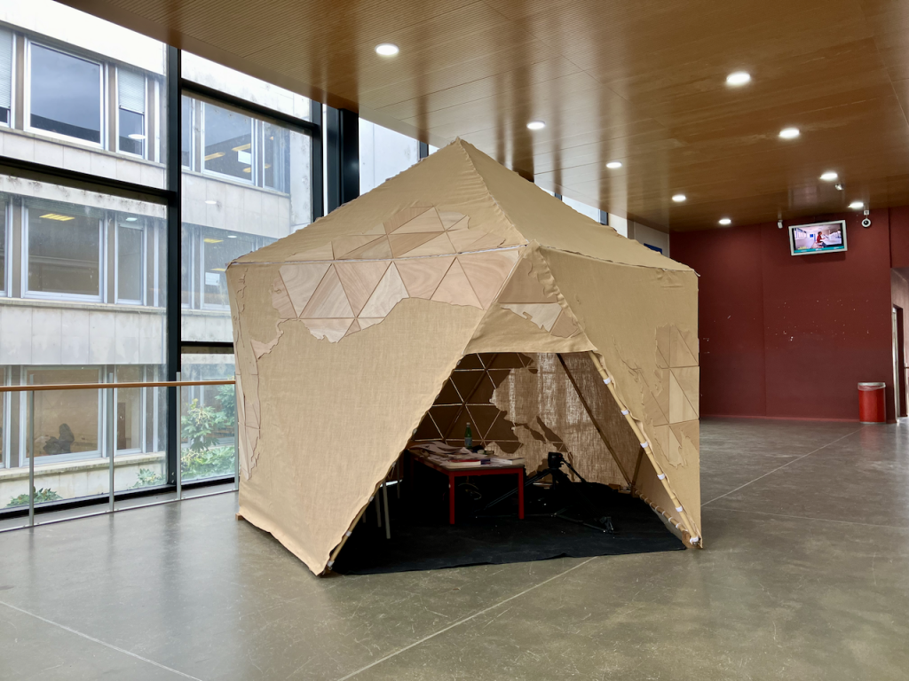
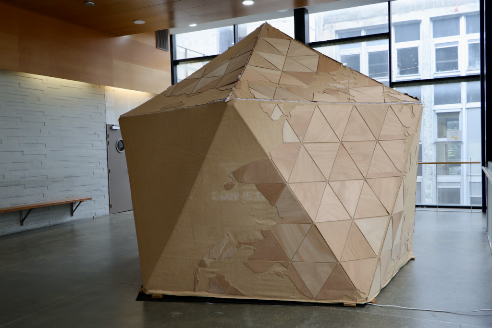
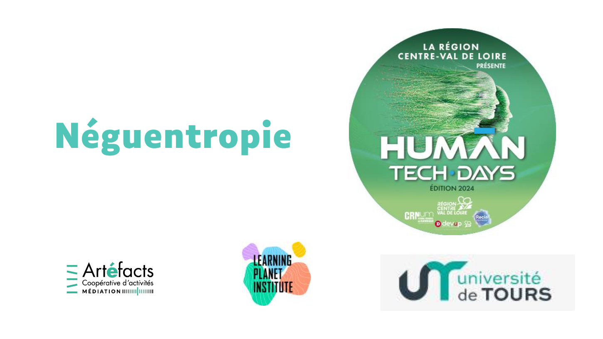

[Néguentropie](http://neguentropie.art/) est une installation artistique qui vise à mobiliser les savoir-faire des participants en leur proposant de réaliser la construction d’un espace ludique et d'expérimenter un atelier de cartographie. A partir des recherche de Bernard Stiegler sur la néguanthropie, de Philippe Rivière sur les projections cartographiques et de quelques références au monde de Jean Oury, cet atelier permet de découvrir la diversité des représentations possibles de la planète et d'interroger leurs influences sur notre perception du monde.  
  
_L'installation artistique Néguentropie se base sur la notion d'art en tant qu'expérience à vivre_

**Comment les représentations (carto)graphiques du monde transforment-elles nos représentations mentales ?**  
Ce questionnement est l’opportunité de faire émerger une multiplicité de points de vues et de nouvelles bifurcations qui seront documentées à travers un dispositif numérique permettant le partage des expériences et leur interprétation dans l'après-coup.

Dispositif numérique : [https://do.doc.neguentropie.art/neguentropie-universite-de-tours](https://do.doc.neguentropie.art/neguentropie-universite-de-tours)

Programme : [https://ash.univ-tours.fr/loeuvre-neguentropie](https://ash.univ-tours.fr/loeuvre-neguentropie)

Partenariat : [https://www.learning-planet.org/event/neguentropie/](https://www.learning-planet.org/event/neguentropie/)

