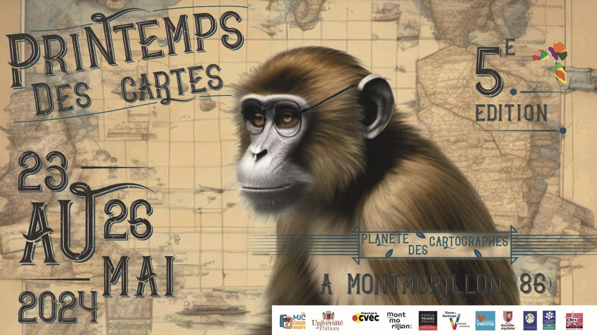
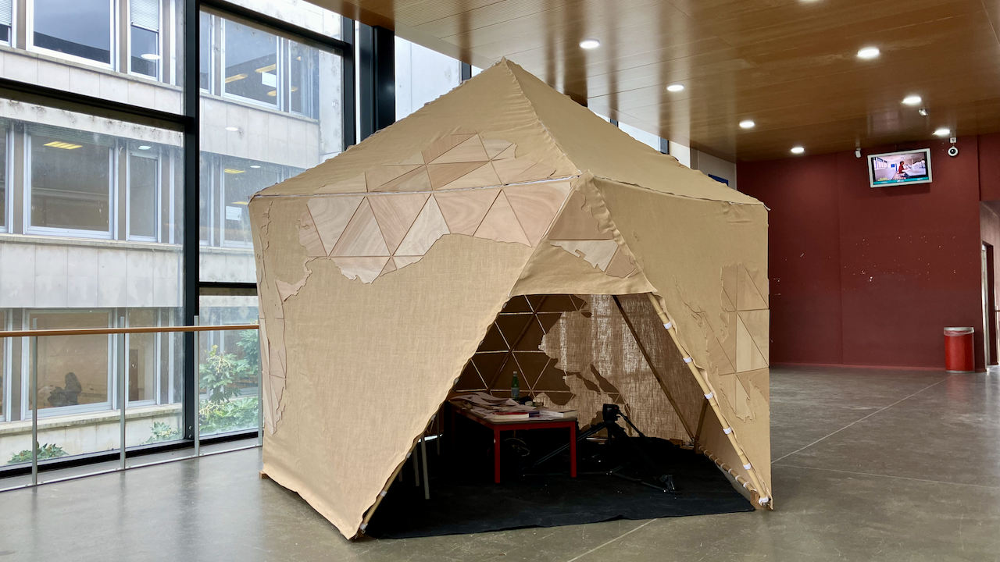

## Néguentropie : Une invitation à la création et à la réflexion

###### Festival du Printemps des Cartes du 23 au 26 Mai 2024 à Montmorillon (86)

L'installation [Néguentropie](https://neguentropie.art/), conçue en 2020 par **[Aline Perdereau](https://www.linkedin.com/in/aline-perdereau-1b6a08179/)**, **[Luc Léger](https://mediation.artefacts.coop/equipe/lucleger/)**, **[Philippe Rivière](https://illisible.net/philippe-riviere)** et [Erwan Bozec](https://pixflowave.fr/) membres de la [coopérative Artéfacts](https://www.artefacts.coop/), va au-delà d'une simple exposition d'art. Elle se veut une expérience immersive et interactive qui invite les participants à s'impliquer activement dans le processus de création.

## Un espace ludique et collaboratif

Les visiteurs sont conviés à participer à la construction d'un espace en forme d’icosaèdre ludique et stimulant représentant la projection [AirOcean de Fuller](https://observablehq.com/@fil/airocean-projection). Cet espace, conçu collectivement à partir des travaux de recherche de [Philippe Rivière](https://illisible.net/philippe-riviere) sur [D3js.org](https://d3js.org/) devient le support d'une réflexion sur les représentations du monde et les liens profonds entre cartographie et imaginaire.

## Un atelier de cartographie pour explorer les perceptions

Suite à la construction de l'espace ludique, un atelier de cartographie est proposé aux participants. Cet atelier, animé par [Erwan Bozec](https://pixflowave.fr/), permet de découvrir la diversité des représentations de planètes grâce au support [planète de papier](https://www.visionscarto.net/la-recette-des-planetes-de-papier) réalisé par [Philippe Rivière](https://illisible.net/philippe-riviere) . Ces différentes projections de papier permettent de fabriquer à l'aide de simples découpages des objets en 3D. Le temps de ces réalisations interroge notre perception du monde. Les participants découvrent comment les cartes, loin d'être des représentations neutres de l'espace, sont imprégnées de nos perceptions, de nos valeurs et de notre imaginaire. Afin de conserver une trace de ces contributions il est proposé de réaliser une [vidéo time lapse](https://do.doc.neguentropie.art/_publications/neguentropie/) qui pourra ensuite être publiée sur l'espace numérique [Dodoc](https://do.doc.neguentropie.art/neguentropie-festivale-printemps-des-cartes) développé par [l'atelier des chercheurs](https://latelier-des-chercheurs.fr/).

## **Un dialogue entre l'art et la science**

[Néguentropie](https://neguentropie.art/) se distingue par son approche interdisciplinaire, mêlant harmonieusement art, science et technologie. Elle favorise le dialogue entre ces domaines, soulignant le pouvoir de la cartographie comme outil d'exploration et de création. Néguentropie s'inscrit pleinement dans le cheminement de [Bernard Stiegler](https://organoesis.org/) qui propose de [p(a)nser](http://www.editionslesliensquiliberent.fr/livre-Qu%E2%80%99appelle_t_on_Panser%C2%A0_-555-1-1-0-1.html) les outils numériques de manière à stimuler davantage la [noodiversité](https://organoesis.org/themes/epistemologie-anti-entropie-et-anti-anthropie) que la grégarisation des comportements. C'est aussi une sensibilisation à la notion de l'importance du rôle du rythme dans le passage du chaos à l'ordre. C'est par le rythme, selon [Henry Maldiney](https://rhuthmos.eu/spip.php?article477) que du chaos initial de l'abîme décrit par Paul Klee comme étant un point gris, se cristallise le monde structuré et organisé que nous percevons.

## **Une expérience accessible à tous**

Néguentropie s'adresse à un large public, curieux de cartographie, d'art ou simplement désireux de découvrir de nouvelles perspectives sur le monde. L'installation et l'atelier sont conçus pour être accessibles à tous, avec des supports d'information et des activités adaptées aux différents publics.

## **Un rendez-vous à ne pas manquer**

Le [Festival du Printemps des Cartes](https://www.printempsdescartes.fr/) est l'occasion rêvée de découvrir l'installation [Néguentropie](https://neguentropie.art/) et de participer à l'atelier de cartographie. Un rendez-vous à ne pas manquer pour tous ceux qui souhaitent explorer les liens entre cartographie, art, science et imaginaire !

L'installation artistique [Néguentropie](https://neguentropie.art/) propose une expérience unique qui invite le public à explorer le concept du point gris, de la néguentropie et du pouvoir transformateur de l'art.

En créant un espace immersif et propice à l'expérimentation, Néguentropie nous encourage à repenser nos perceptions du monde et à découvrir de nouvelles possibilités de création.

### **Licence Art Libre**

Il est important de noter que l’œuvre [Néguentropie](https://neguentropie.art/) est [sous licence Art Libre](https://artlibre.org/), permettant sa diffusion, sa modification et sa reproduction selon les termes de la licence. Cela encourage la collaboration et le partage des connaissances, en accord avec l’esprit d’ouverture et d’échange qui anime l’installation.
