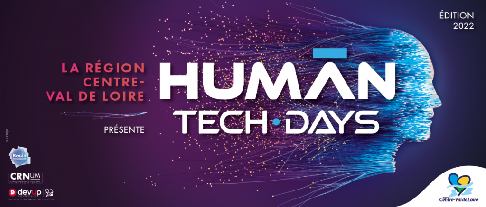

## Néguentropie | La Fabrique de Blois

Le 6 et 13 Mai 2022 à [La Fabrique de Blois](https://livemap.getwemap.com/embed.html?emmid=19631&token=5XNRCH81DMKE5BQL8L51HTOGB&wemapHash=%23%2Fpinpoints%2F41228427#/pinpoints/41228427)

**[Néguentropie](https://neguentropie.art/)** est une installation artistique participative qui vise à utiliser le Numérique et la Data visualisation pour remettre l’humain au centre des usages. 

Elle propose de créer un espace de sensibilisation où science, philosophie et art s’agrègent dans une activité ludique, véritable expérience à vivre.

Accessibilité des outils et techniques ouvertes.

Le “spectateur” n’est plus dans la position d’apprenant ni de consommateur d’outils numériques, mais bien dans celle du collaborateur qui fait advenir l’œuvre. Cette réflexion se décline concrètement par l’aménagement mobilier d’un espace propice à l’expérimentation à construire avec les participants puis, un atelier [Paper Planet](https://pixflowave.fr/video-time-laps-paper-planet) est proposé au public (construction d’un globe terrestre projeté à partir de données numériques grâce au logiciel [D3.js](https://d3js.org/)).

Une trace de l’expérience est conservée grâce au son, à la vidéo, à l'écrit via la plate-forme [Do.doc](https://dodoc.fr/) en direct, le tout sous [Licence Art-Libre](https://artlibre.org/).

* * *

Lors de la rencontre du 6 Mai 2022, **[Anne Alombert](https://organoesis.org/anne-alombert)** enseignante-chercheuse en philosophie à l'Université Paris 8 et co-auteure du livre [_Bifurquer_](http://www.editionslesliensquiliberent.fr/livre-Bifurquer-609-1-1-0-1.html), co-écrit avec le philosophe **Bernard Stiegler** et le [collectif Internation](https://internation.world/), interviendra sur les thèmes de la _**"néguanthropologie"**_ et du _**Néguanthropocène,**_ développé par [Bernard Stiegler,](https://organoesis.org/entropocene-et-epistemologie-complements) à partir des notions d'entropie, néguentropie, anthropie, anti-anthropie.

* * *

La Musique est représentée par **NIRINTSOA**, un artiste-entrepreneur, musicien, comédien & auteur, compositeur-beatmaker, interprète. Originaire de Blois et familier des lieux - [La Fabrique de Blois](https://www.blois.fr/annuaire/espaces-jeunes/la-fabrique) - il nous propose de **découvrir** le cheminement de sa création musicale, liant technique, philosophie de vie et émotions, à la recherche d’un nouveau rythme, essence même de l’existence humaine. Cet ancien _finaliste_ de la **Nouvelle Star(2016)**, nous montre une facette peu connue. **Le travail de l'ombre d'un compositeur.**

* * *

Lors de la rencontre du 13 mai 2022, **Antoine Moreau**, artiste, enseignant-chercheur en Arts à l'Université de Franche-Comté et co-rédacteur de la [Licence Art-Libre](https://artlibre.org/), interviendra en début d'après-midi pour répondre aux questions concernant l'art libre avec une mise en pratique par le dessin. [https://oeuvres.artlibre.org/neguentropie/](https://oeuvres.artlibre.org/neguentropie/)

* * *

**Un buffet** en relation avec la notion de _Néguentropie_ sera proposé par les _**jeunes**_**de la Fabrique de Blois**, ainsi qu’un **enregistrement radiophonique**.

* * *

[https://neguentropie.art/](https://neguentropie.art/) Contact : **Erwan Bozec** 0628345624, **Abdellah Bouikelfiden** 0254585797
