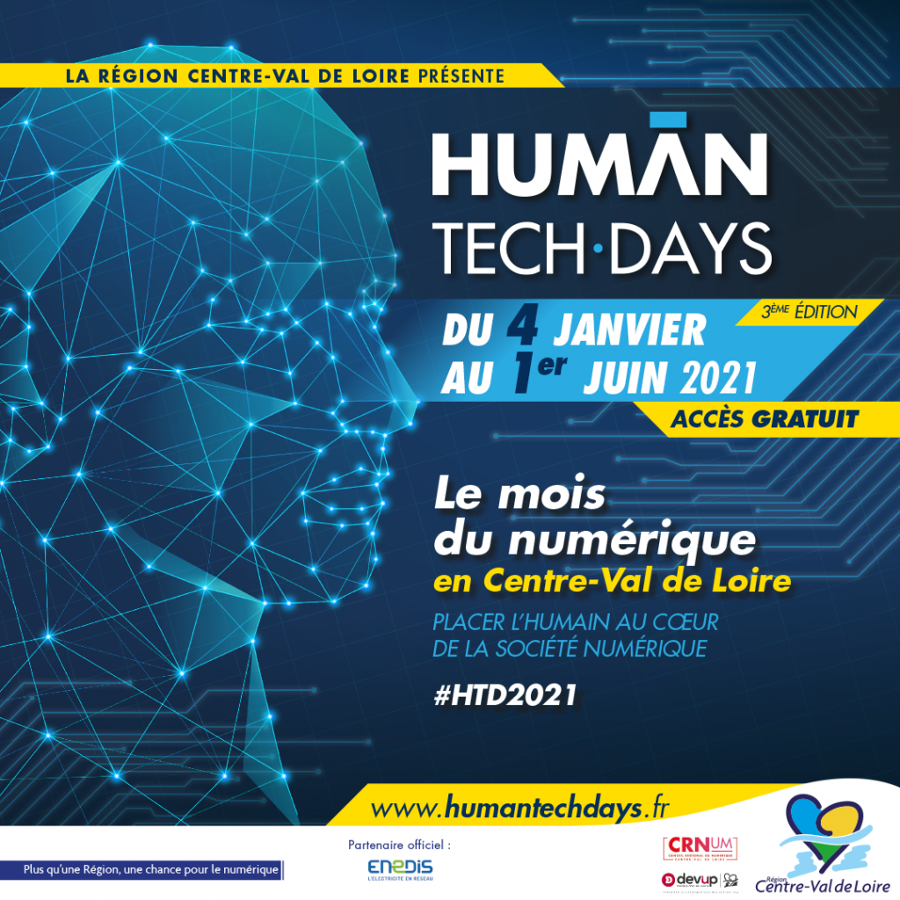
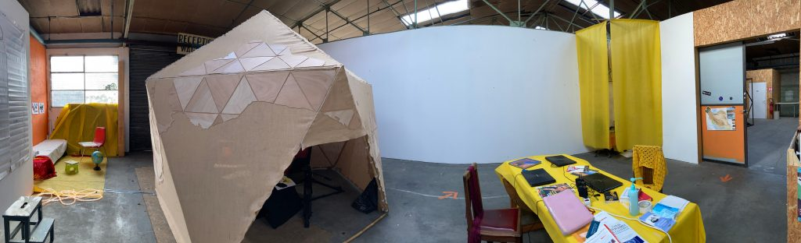
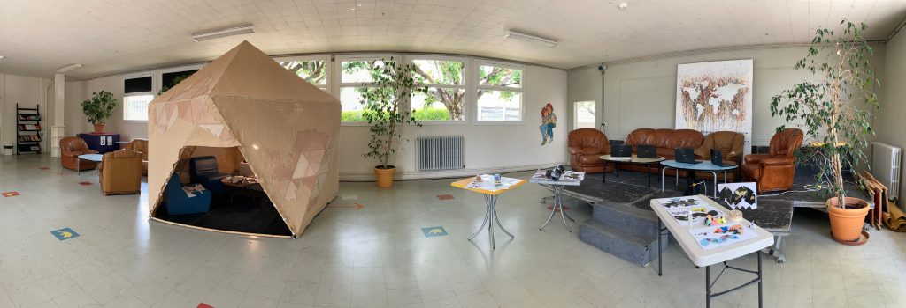

Prochainement l’œuvre [Néguentropie](https://neguentropie.art/) sera présenté dans le cadre des Human Tech Days

Dates et lieux prévus

- La Fabrique de la ville de Blois le 21 et 22 Mai

- Atelier de la Morinerie à Saint-Pierre des Corps les 7 et 8 Mai
